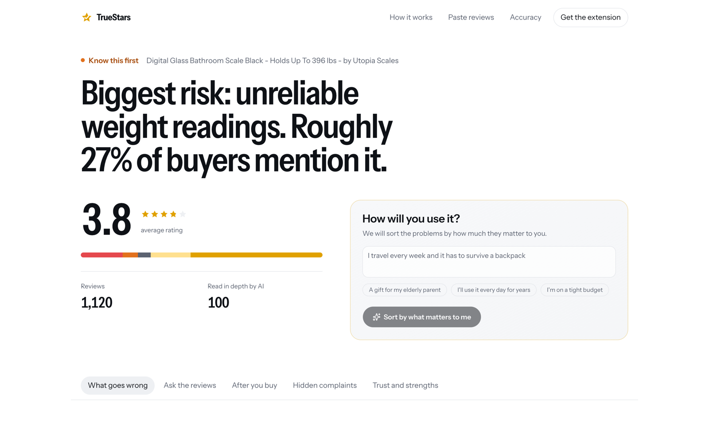
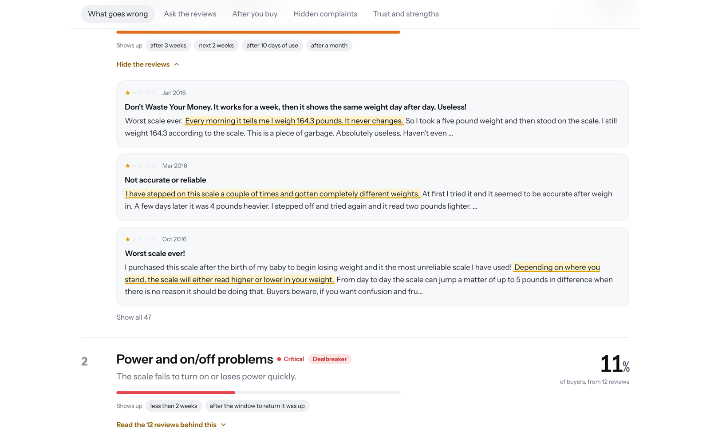

# TrueStars

**Know what goes wrong before you buy.**

TrueStars reads a product's reviews and tells you what actually goes wrong, how many buyers report it, and whether it matters to you. Every claim links to the reviews behind it.

**Live demo:** https://truestars.vercel.app  ·  **Chrome extension:** https://truestars.vercel.app/extension

*Submitted to SLAY HACKS 2026.*



## The problem

A star rating is an average, and averages hide things. A bathroom scale on Amazon has 3.8★, and 612 of its 1,120 reviews give it five stars. But roughly **27% of buyers report that it gives unreliable readings**. Nobody reads 1,000 reviews to find that out, and the star rating can't show it.

Most review tools give you a single trust score. TrueStars answers the question a buyer actually has: **what's the catch, how common is it, and does it matter for me?**

**Who it's for:** anyone shopping online, on any site, in any country.

## What it does

- **Dealbreakers.** Recurring problems grouped into themes. Each shows its severity, an estimate of how many buyers report it, and when it tends to happen ("after 3 weeks").
- **Evidence for every claim.** Each problem opens into the real reviews, with the exact sentence highlighted.
- **Fits you.** Describe how you'll use the product ("a gift for my elderly parent"). Problems are re-ranked as *matters to you*, *might matter* or *probably not for you*, each with a reason.
- **Ask the reviews.** Ask any question ("Does it work on carpet?"). The answer comes only from matching reviews, with citations. If nobody mentions it, TrueStars says so.
- **Can you trust the stars?** Checks a person can verify: bursts of 5★ reviews on one day, copy-pasted wording, free-product disclosures, empty 5★ reviews.
- **Complaints hidden in 4★ and 5★ reviews.** Problems that happy reviewers mention but that never lower the average.
- **Before your return window closes.** What to test in the first week, plus a chart of when serious failures tend to appear.

There are three ways to use it:
1. Sample reports on the website.
2. Paste reviews from any site.
3. The Chrome extension, which reads the reviews on the product page you're viewing.



## How the AI works

```
reviews → selection → extraction (LLM) → quote check → grouping (LLM) → counting in code → report
```

| Step | What happens | Model or method |
|---|---|---|
| Selection | Up to 100 of the most informative reviews: low-star reviews first, then the most detailed positive ones | Code |
| Extraction | For each review: problem labels, severity, timeframe and an **exact quote**. 20 reviews per call, JSON output validated with zod | `openai/gpt-oss-20b` on Groq |
| Quote check | Any quote not found word for word in the review is dropped | Code |
| Grouping | Labels are merged into at most 8 problem themes; any label the model invents is discarded | `openai/gpt-oss-120b` on Groq |
| Counting | Shares are calculated in code and re-weighted to the product's real star mix, because low-star reviews were over-sampled | Code |
| Trust checks | Bursts, duplicates, disclosures and rating shape | Statistics, no AI |
| Ask the reviews | BM25 search in the browser finds the relevant reviews; the model answers only from those and cites them | BM25 + `gpt-oss-120b` |
| Fits you, checklist | Re-ranks problems for the user's situation; writes the first-week checklist | `gpt-oss-120b` |

**Results on the three sample products** (3,175 real Amazon reviews, 280 read in depth):
- **278 of 284 AI quotes (98%) matched the review word for word.** The other 6 were dropped.
- 17 recurring problems found.

## Responsible AI

- **No mystery scores.** Every number links to its evidence.
- **No "fake review" or "AI-written" accusations.** Detectors for that are unreliable, so TrueStars only flags patterns a person can check.
- **No invented quotes.** If the model's quote isn't in the review, it is dropped.
- **Review text is treated as data.** Prompts tell the model to ignore instructions inside reviews, and every output is schema-validated.
- **No scraping, no accounts.** The extension uses Chrome's `activeTab` permission, so it reads only the page you're on and only when you click it. Nothing is stored on the server.
- **Honest limits.** Unhappy buyers write reviews more often, so the percentages are signals, not guarantees. The report says so.

## Try it

**Website.** Open https://truestars.vercel.app and pick a sample product, or paste reviews from any site. No sign-up is needed.

**Chrome extension**
1. Download the zip from https://truestars.vercel.app/extension and unzip it.
2. Open `chrome://extensions` and turn on **Developer mode** (top right).
3. Click **Load unpacked** and choose the unzipped folder (the one that contains `manifest.json`).
4. Open a product page, scroll to the reviews, and click the TrueStars icon. The report opens in a side panel.

**Where the extension works:**
- Amazon and Flipkart, each with a dedicated reader.
- A general reader that recognises review lists on most other shops. It has been tested on eBay, noon, Nykaa, IKEA, Decathlon and Snapdeal.
- Any site with schema.org review data.
- Google Maps reviews.
- Any review text you select.

## Run it locally

You need Node 22 and a free [Groq API key](https://console.groq.com).

```bash
git clone https://github.com/KartikManral092006/Truestars.git
cd Truestars/web
cp .env.example .env.local   # put your key in GROQ_API_KEY
npm install
npm run dev                  # http://localhost:3000
```

To use the extension with your local server, click **Settings** in the side panel and enter `http://localhost:3000`.

## Tech stack

- **Web:** Next.js 16, React 19, TypeScript, Tailwind CSS v4, GSAP, three.js.
- **AI:** Groq (`gpt-oss-20b` and `gpt-oss-120b`), with zod for output validation.
- **Extension:** Chrome Manifest V3, side panel.
- **Hosting:** Vercel.

## Project structure

```
web/
  src/app/            pages, plus API routes: extract, themes, fit, checklist, ask
  src/lib/            report builder, statistics, search, evaluation
  src/lib/server/     Groq client: JSON repair and retries
  src/components/     report and landing-page UI
  public/samples/     sample products and their pre-computed reports
extension/            Chrome extension: side panel and the review readers (extract.js)
```

## Limitations

- The extension reads only the reviews already loaded on the page, often 10–20. Opening "See all reviews" first gives better results.
- Some shops change their pages often. If a page isn't recognised, select the review text and click the icon.
- The percentages describe people who wrote reviews, not every buyer.
